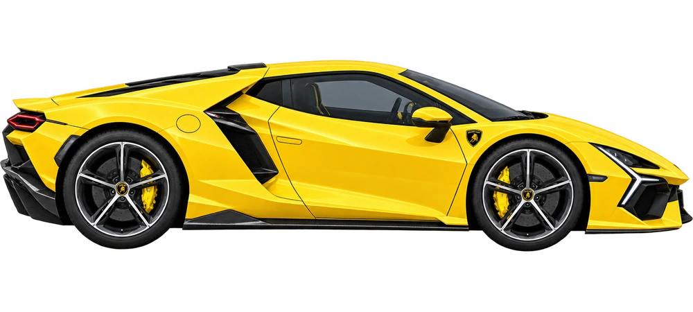

# 🚗 汽车游乐园 · CarPlayground

**选一辆爱车，用小手发现一个世界。**

[🌈 打开汽车游乐园，开始试玩](https://carplayground.wynsunny.cn/#/explore)

这里是一个可以动手玩的儿童汽车世界。推一推跑车，拖进停车位，擦掉泥点，把车身和轮子装起来，再开去看看别的发现。

本分支正在开发 **0.6.0 触控重构版**；上述在线试玩为已发布版本，本次重构尚未发布。

## 🖐️ 小手碰到哪里，发现就从哪里开始

| 想做什么？ | 怎么玩？ |
| --- | --- |
| 🫧 给小车洗个澡 | 手指擦过车身，泥点沿着轨迹消失。哪里没洗到，再去找一找。 |
| 🛞 装好自己的跑车 | 把车身、车轮拖到轮廓上，看零件一点点合在一起。 |
| 🅿️ 帮小车找个家 | 直接拖着车开进空位，已经停着朋友的地方就让一让。 |
| 🖐️ 推一下，松开手 | 车会继续滑行、慢慢停下。再推轻一点，看看有什么不同。 |
| 🌉 搭桥，接小路 | 拖桥板、转路块，连通以后，小车真的从上面走过去。 |
| 🎨 留下自己的作品 | 摆放小物件，推车画轮印，作品留在自己的小车库。 |

玩法从物体和手势开始。孩子可以先看一次手势示范，然后自己试；不用先读一排文字答案，也不用点“完成”才算玩过。

## 🏎️ 三十辆，都是新制作的游戏跑车

从兰博基尼、法拉利、保时捷、迈凯伦，到路特斯、阿尔派和马自达，30款跑车采用 GPT 重新生成的游戏素材。

每辆都有侧面和俯视图，可以参与停车、清洗、装配和探索。这里展示的是适合游戏的车型演绎，方便观察和动手。

## 🌱 玩着，也发现着

- 擦洗和装配时，观察局部、位置和部件。
- 停车、整理与装东西时，接触数量、配对和顺序。
- 推车、换路面、移动光源时，尝试改变条件、比较结果。
- 摆放场景、画轮印时，自由创作，也和家人讲讲自己的发现。

中文陪伴与英语点读可以随时重听。收藏、作品、故事与活动记录保存在当前浏览器，支持导出备份，无需注册账号。

🧰 开发者与素材来源

启动、检查和贡献说明见 [DEVELOPMENT.md](DEVELOPMENT.md)。

新游戏车辆的生成提示词与生产记录见 [content/play-cars-production.json](content/play-cars-production.json)。历史照片来源和署名记录继续保留；各素材适用范围以对应记录为准，声音听审和分发依据仍待确认。

