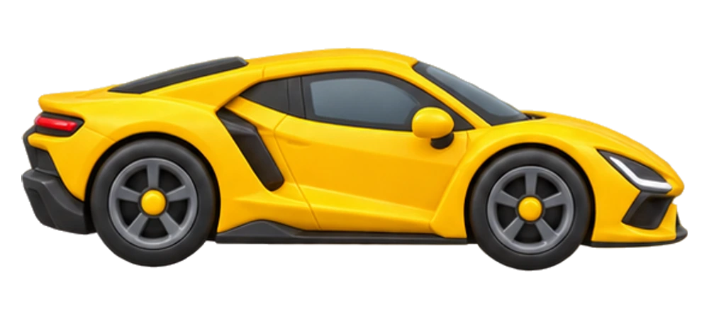

# 🚗 汽车游乐园 · CarPlayground

**选一辆爱车，用小手发现一个世界。**

[🌈 打开汽车游乐园，开始试玩](https://carplayground.wynsunny.cn/#/explore)

这里是一个可以动手玩的儿童汽车世界。推一推跑车，拖进停车位，擦掉泥点，把车身和轮子装起来，再开去看看别的发现。

当前版本为 **0.13.1 真实车型与立体玩法审阅版**。

## 🖐️ 小手碰到哪里，发现就从哪里开始

| 想做什么？ | 怎么玩？ |
| --- | --- |
| 🫧 给小车洗个澡 | 手指擦掉泥点。第一辆洗好再交换，让等待的小车也洗个澡。 |
| 🛞 装好自己的跑车 | 把车身、车轮放回轮廓。可以拖，也可以点零件再点轮廓。 |
| 🅿️ 帮小车找个家 | 直接拖着车开进空位，已经停着朋友的地方就让一让。 |
| 🖐️ 推一下，松开手 | 两辆相同小车接受同样推动，看看光滑和粗糙路面上谁停得更近。 |
| 🌉 搭桥，接小路 | 比一比桥板长度；从三块小路开始，转好后让车一路开到公园。 |
| 🎨 留下自己的作品 | 摆放小物件，推车画轮印，作品留在自己的小车库。 |

首页、选车、车库与故事都用场景图片和大图标作为入口；文字说明收在家长区域。玩法从物体和手势开始。孩子不会时可以点小手按钮，翻看三步图示，再收起演示自己试；演示不会替孩子完成游戏。不用先读一排文字答案，也不用点“完成”才算玩过。

## 🏎️ 真实量产车型与立体玩法

车库按品牌和车型系列去重，同一车型的年款、配置、车漆、改装和地区别名不重复计数；概念车、纯赛车以及身份不明的模型不进入车库；社区游戏外观可有风格化或改装细节，但不增加车型数量。当前有66个车型系列，其中50款有独立立体模型，另16款为明确标注的参考图，模型尚待补齐。经典停产量产车也包含在内，并不表示这些车型现在都可购买新车。八辆一页，支持品牌筛选。

车型身份和厂家参考见 [车型身份表](content/vehicle-identities.json)，社区模型的作者、来源和许可见 [模型署名表](content/VEHICLE_MODEL_CREDITS.md)。模型、运动与装配是游戏示意，不代表厂商工程数据、真实性能或维修步骤。

新车型名称仅在设备提供本地中文语音时朗读；无本地声音时不调用远程服务。原有随包语音继续可用。

## 🌱 玩着，也发现着

- 擦洗和装配时，观察局部、位置和部件。
- 停车、整理与装东西时，接触数量、配对和顺序。
- 推车、换路面、移动光源时，尝试改变条件、比较结果。
- 摆放场景、画轮印时，自由创作，也和家人讲讲自己的发现。

放错时，轮廓会帮忙。孩子需要时再点开图示帮助，不会反复弹出教学。红绿灯、颜色配对、雨天打包和出发准备，都通过画面里的物件操作。

玩法完成后会出现下一站的场景邀请，也可以继续玩或重来。26个玩法各有三种贴合操作的反馈；设备有本地中文声音时会朗读短句，没有时使用随包音频，不调用远程语音服务。颜色车触碰播放对应英文，红绿灯的动作与 go / stop 对应。

中文陪伴与英语点读可以随时重听。收藏、作品、故事与活动记录保存在当前浏览器，支持导出备份，无需注册账号。

🧰 开发者与素材来源

启动、检查和贡献说明见 [DEVELOPMENT.md](DEVELOPMENT.md)。

游戏车的生成提示词与生产记录见 [侧视/俯视素材](content/play-cars-production.json)及[六角度外观素材](content/car-turnarounds-production.json)。历史照片来源和署名记录继续保留；各素材适用范围以对应记录为准，声音听审和分发依据仍待确认。

